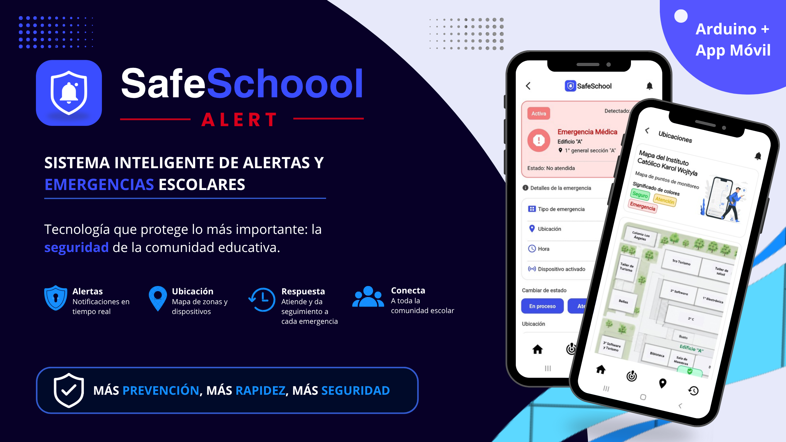
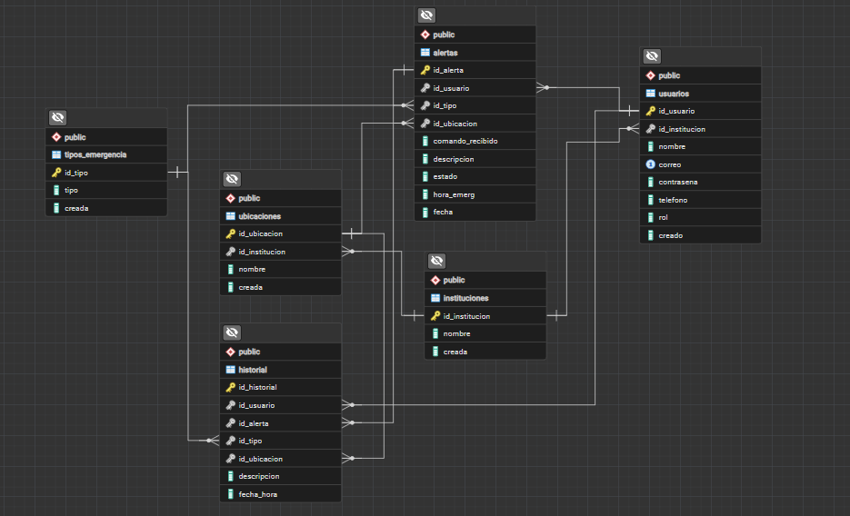

# SafeSchool Alert
**Sistema inteligente de alertas y emergencias escolares**

Este repositorio contiene la estructura de la base de datos para el sistema **SafeSchool Alert**, incluidas las instrucciones necesarias para las consultas de datos, operaciones de manipulación, uniones de tablas y consultas SQL avanzadas diseñadas para recuperar los datos más precisos que el sistema utlizará.

---

# Tabla de contenido

- [SafeSchool Alert: Base de Datos](#safeschool-alert-base-de-datos)
- [Descripción del proyecto](#descripción-del-proyecto)
- [Problema](#Problema)
- [Solución](#solución)
- [Objetivos](#objetivos)
- [Tecnologías utilizadas](#tecnologías-utilizadas)
- [Integrantes y responsabilidades](#integrantes-y-responsabilidades)
- [Base de datos](#base-de-datos)
  - [Nombre de la base de datos](#nombre-de-la-base-de-datos)
  - [Sistema gestor](#sistema-gestor)
- [Estructura de la base de datos](#estructura-de-la-base-de-datos)
- [Correspondencia](#funciones-de-la-aplicación-y-correspondencia-appbd)
- [Consultas principales](#consultas-principales)
- [Seguridad](#seguridad)
- [Funcionalidades](#funcionalidades)
- [Relaciones entre las tablas](#relaciones-entre-las-tablas)
- [Evidencias](#evidencias)
- [Enlace de documento final](#enlace-de-documento-final)
- [Estado del proyecto](#estado-del-proyecto)
  - [Aplicación](#aplicación)
  - [Base de datos](#base-de-datos)
  - [GitHub](#github)
  - [Documentación](#documentación)
- [Estructura del repositorio](#estructura-del-repositorio)
- [Instalación y Configuración](#instalación-y-configuración)
  - [1. Prerrequisitos](#1-prerrequisitos)
  - [2. Clonar el repositorio](#2-clonar-el-repositorio)

## Descripción del proyecto

**SafeSchool Alert** es un sistema de alertas escolares diseñado para facilitar la comunicación y gestión de situaciones de emergencia dentro de una institución educativa.

El sistema integra una aplicación móvil desarrollada con **MIT App Inventor** y un sistema electrónico basado en **Arduino Uno**, permitiendo detectar, registrar y gestionar diferentes tipos de emergencias.

La base de datos desarrollada en **PostgreSQL** permite almacenar la información necesaria para el funcionamiento del sistema, incluyendo instituciones, usuarios, ubicaciones, tipos de emergencia, alertas e historial de emergencias detectadas.

## Problema

Los problemas dentro de los salones escolares son algo que ocurre todo el tiempo, ya sean emergencias médicas, peleas entre estudiantes o decomiso de artículos. Actualmente, en el instituto, cuando ocurren problemas, solamente se notifica por mensaje o llamada y, en el peor de los casos, los docentes tienen que ir directamente a dirección, lo que, en caso de algo muy urgente, puede poner en riesgo la salud del estudiante o docente si se trata de una emergencia médica.

## Solución

Ante esta problemática, se ve la necesidad de implementar un sistema de alertas desarrollado en **MIT App Inventor** que sea capaz de alertar de manera más eficiente cuando surjan emergencias en la institución. El uso de este permitiría actuar de manera más rápida y evitar riesgos dentro de la institución, además de salvaguardar la seguridad de estudiantes y docentes del Instituto Católico Karol Wojtyla. Asimismo, podría brindar un nuevo nivel de seguridad a la institución.

---

## Objetivos

**General**

Desarrollar un sistema inteligente de alertas escolares utilizando MIT App Inventor y una Base de Datos de PostgreSQL para almacenar las emergencias que ocurran en el instituto.

**Especificos**

- Diseñar un sistema que mejore la seguridad dentro de la institución educativa mediante el uso de tecnologías, para un entorno escolar más seguro para estudiantes, docentes y personal administrativo.

- Mejorar el tiempo de respuesta del personal docente y administrativo ante situaciones de emergencia, mediante el envío de notificaciones que permita actuar de manera más rápida.

## Tecnologías utilizadas

| Tecnología         | Uso                                                                                                                                                            |
| ------------------ | -------------------------------------------------------------------------------------------------------------------------------------------------------------- |
| PostgreSQL         | Sistema gestor de bases de datos utilizado para almacenar y administrar la información del proyecto.                                                           |
| pgAdmin 4          | Herramienta de administración de PostgreSQL que permite gestionar la base de datos y ejecutar consultas y sentencias SQL.                                      |
| Visual Studio Code | Editor de código utilizado para editar y organizar los archivos y la estructura del proyecto.                                                                  |
| Git                | Sistema de control de versiones que permite mantener un historial de los cambios realizados en el proyecto y facilitar el trabajo colaborativo mediante ramas. |
| GitHub             | Plataforma utilizada para alojar el repositorio del proyecto en la nube y facilitar la colaboración entre los integrantes del equipo.                          |
| Arduino Uno        | Microcontrolador principal en cargado de la activación de emergencias médiante pulsadores y automatica con el sensor MQ-2                                      |
| C++                | Desarrollo de la progrmación para el circuito electronico del proyecto                                                                                         |
| Tinkercad          | Simulación del circuito electrónico del proyecto SafeSchool Alert                                                                                              |

---

## Funcionalidades

- **Registro de usuarios:** Permite registrar nuevos usuarios mediante su nombre, correo electrónico y contraseña.

- **Inicio de sesión:** Permite a los usuarios registrados acceder a la aplicación utilizando sus credenciales.

- **Cierre de sesión:** Permite cerrar la sesión de la cuenta actual.

- **Comunicación con Arduino Uno mediante Bluetooth:** Establece la comunicación entre la aplicación móvil y el Arduino Uno mediante el módulo Bluetooth HC-05, permitiendo intercambiar información relacionada con las emergencias.

- **Activación manual de emergencias:** Permite activar emergencias desde la aplicación, seleccionando el tipo de emergencia y la ubicación correspondiente.

- **Gestión de estados de las emergencias:** Permite actualizar el estado de una emergencia a _en proceso_, _atendida_ o _falsa alarma_, facilitando su seguimiento.

- **Gestión de emergencias por reconocimiento de voz:** Permite utilizar instrucciones de voz para realizar acciones relacionadas con la gestión de emergencias, como atenderlas o cambiar su estado.

- **Ubicación de las emergencias:** Permite identificar y visualizar en un mapa de la institución educativa el lugar donde se ha generado una emergencia, junto con información sobre el tipo de incidente.

- **Historial de emergencias:** Permite consultar las emergencias registradas, incluyendo información como el tipo de emergencia, la fecha y el usuario encargado de atenderla.

- **Gestión del perfil de usuario:** Incluye una sección destinada a consultar y gestionar la información de la cuenta del usuario. Algunas funciones de esta sección continúan en desarrollo.

- **Creación y publicación de avisos y comunicados:** Permite a los usuarios autorizados crear avisos para comunicar información importante a la comunidad educativa.

- **Configuración de la aplicación:** Permite configurar opciones relacionadas con Bluetooth, alarmas, vibraciones y mensajes SMS.

## Integrantes y responsabilidades

| Integrante                          | Responsabilidad                                                                                                                                                                                |
| ----------------------------------- | ---------------------------------------------------------------------------------------------------------------------------------------------------------------------------------------------- |
| **José Rolando Velasco Peña**       | En cargado de la revisión, corrección y desarrollo de nuevas funcionalidades y realización de las pruebas de la aplicación móvil en MIT App Inventor.                                          |
| **Luis Mario Meléndez Escobar**     | Actualización, organización y documentación de la base de datos PostgreSQL que se utilizara para el proyecto en versiones futuras del proyecto al momento de conectarse mediante una API REST. |
| **Ulises de Jesús Mercado Alberto** | Elaboración de la documentación técnica del proyecto, y preparación de los recursos visuales y de exposición del stand para la precentación del proyecto.                                                                                                                  |

---

## Base de datos

### Nombre de la base de datos

```text
safeSchool_alert
```

### Sistema gestor

```text
PostgreSQL
```

> [!NOTE]
> La base de datos fue desarrollada utilizando tablas relacionadas mediante **claves primarias y claves foráneas**, permitiendo mantener una estructura organizada para la información del sistema.

---

## Estructura de la base de datos

### Tablas principales

La base de datos está compuesta por las siguientes tablas:

| Tabla              | Descripción                                                            |
| ------------------ | ---------------------------------------------------------------------- |
| `instituciones`    | Almacena la información de las instituciones educativas registradas.   |
| `usuarios`         | Almacena los usuarios asociados a una institución.                     |
| `ubicaciones`      | Registra las diferentes ubicaciones dentro de una institución.         |
| `tipos_emergencia` | Contiene los tipos de emergencia que puede manejar el sistema.         |
| `alertas`          | Registra las emergencias y alertas generadas dentro de la institución. |
| `historial`        | Conserva el registro histórico de las alertas y eventos gestionados.   |

---

## Correspondencia

SafeSchool Alert utiliza información almacenada en PostgreSQL para realizar diferentes funciones dentro de la aplicación. La siguiente tabla muestra la relación entre las principales funciones de la aplicación móvil, las tablas de la base de datos y las operaciones SQL que serán necesarias para la aplicación pueda funcionar gestioanar cada una de las emergencias de forma correcta.

| Función de la aplicación                       | Tabla PostgreSQL   | Operación SQL   | Información utilizada                                                     |
| ---------------------------------------------- | ------------------ | --------------- | ------------------------------------------------------------------------- |
| Identificar usuario                            | `usuarios`         | SELECT          | Nombre, correo y rol del usuario                                          |
| Registrar una alerta                           | `alertas`          | INSERT          | Usuario, tipo de emergencia, ubicación, descripción, fecha, hora y estado |
| Consultar alertas                              | `alertas`          | SELECT          | Tipo de emergencia, ubicación, descripción, fecha, hora y estado          |
| Consultar tipos de emergencia                  | `tipos_emergencia` | SELECT          | Tipos de emergencia disponibles                                           |
| Consultar ubicaciones                          | `ubicaciones`      | SELECT          | Ubicación donde puede generarse una emergencia                            |
| Consultar y actualizar el estado de una alerta | `alertas`          | SELECT / UPDATE | Identificador y estado de la alerta                                       |
| Consultar historial de alertas                 | `historial`        | SELECT          | Emergencia, usuario, ubicación, descripción y fecha y hora                |

## Consultas principales del sistema
### Consulta de alertas con INNER JOIN Y LEFT JOIN

Esta consulta obtiene información completa de las alertas relacionando las tablas `alertas`, `usuarios`, `tipos_emergencia` y `ubicaciones`.

```sql

SELECT
    alertas.id_alerta,
    tipos_emergencia.tipo AS emergencia,
    ubicaciones.nombre AS ubicacion,
    usuarios.nombre AS usuario_atendio,
    alertas.descripcion AS descripcion,
    alertas.fecha AS dia_detectada,
    alertas.hora_emerg AS hora,
    alertas.estado
FROM public.alertas
LEFT JOIN public.usuarios
    ON alertas.id_usuario = usuarios.id_usuario
INNER JOIN public.tipos_emergencia
    ON alertas.id_tipo = tipos_emergencia.id_tipo
INNER JOIN public.ubicaciones
    ON alertas.id_ubicacion = ubicaciones.id_ubicacion;
```

### Consulta de alertas activas

Esta consulta permite identificar cuales son las emergencias que se encuentran activas dentro del sistema.

```sql
SELECT
    alertas.id_alerta,
    tipos_emergencia.tipo AS emergencia,
    ubicaciones.nombre AS ubicacion,
    usuarios.nombre AS usuario_atendio,
    alertas.descripcion AS descripcion,
    alertas.fecha AS dia_detectada,
    alertas.hora_emerg AS hora,
    alertas.estado
FROM public.alertas
LEFT JOIN public.usuarios
    ON alertas.id_usuario = usuarios.id_usuario
INNER JOIN public.tipos_emergencia
    ON alertas.id_tipo = tipos_emergencia.id_tipo
INNER JOIN public.ubicaciones
    ON alertas.id_ubicacion = ubicaciones.id_ubicacion
WHERE alertas.estado = 'ACTIVA';
```

### Consulta de usuarios

Permite consultar información de los usuarios registrados dentro de la institución ordenados alfabéticamente.

```sql
SELECT
   u.id_usuario,
   u.nombre,
   u.correo,
   u.rol,
   i.nombre AS institucion_del_usuario,
   u.creado AS creado_en
FROM public.usuarios u
INNER JOIN public.instituciones i ON u.id_institucion = i.id_institucion;


SELECT
   u.id_usuario,
   u.nombre,
   u.correo,
   u.rol,
   i.nombre AS institucion_del_usuario,
   u.creado AS creado_en
FROM public.usuarios u
INNER JOIN public.instituciones i ON u.id_institucion = i.id_institucion
ORDER BY u.creado DESC;
```

### Consulta del historial de emergencias

Esta consulta permite obtener los registros históricos relacionados con los ventos de cada una de las emrgencia detectadas en el sistema.

```sql
SELECT
    historial.id_historial,
    usuarios.nombre AS usuario,
    alertas.id_alerta,
    tipos_emergencia.tipo AS tipo,
    ubicaciones.nombre AS ubicacion,
    historial.descripcion AS descripcion,
    historial.fecha_hora AS fecha_y_hora
FROM public.historial
INNER JOIN public.usuarios
    ON historial.id_usuario = usuarios.id_usuario
INNER JOIN public.alertas
    ON historial.id_alerta = alertas.id_alerta
INNER JOIN public.tipos_emergencia
    ON historial.id_tipo = tipos_emergencia.id_tipo
INNER JOIN public.ubicaciones
    ON historial.id_ubicacion = ubicaciones.id_ubicacion

```

---

## Seguridad

Para administrar el acceso a la base de datos se creó un usuario específico denominado `safeschool_user`, al cual se le asignaron permisos para conectarse a la base de datos del proyecto SafesSchool Alert, con permisos utilizar el esquema `public` y realizar operaciones SQL CRUD en las tablas del esquema `public`.

Los permisos implementados son:

| Permiso   | Descripción                                       |
| --------- | ------------------------------------------------- |
| `CONNECT` | Permite al usuario conectarse a la base de datos. |
| `USAGE`   | Permite utilizar el esquema `public`.             |
| `SELECT`  | Permite consultar información de las tablas.      |
| `INSERT`  | Permite registrar nueva información.              |
| `UPDATE`  | Permite modificar información existente.          |
| `DELETE`  | Permite eliminar información cuando corresponda.  |

### Usuario de base de datos

```text
Usuario: safeschool_user
Base de datos: safeschool_alert
Esquema: public
```

---

## Relaciones entre las tablas

La estructura de la base de datos permite relacionar la información mediante claves foráneas.



> [!NOTE]
> Diagrama Entidad-relación de la base de datos creada en el gestos de bases de datos PostgresSQL.

### Instituciones → Usuarios

Una institución puede tener diferentes usuarios registrados.

```text
La relación es de: 1 : N
```

La tabla `usuarios` utiliza `id_institucion` como clave foránea relacionada con `instituciones`.

---

### Instituciones → Ubicaciones

Cada ubicación pertenece a una institución determinada.

```text
La relación es de: 1 : N
```

La tabla `ubicaciones` utiliza `id_institucion` como clave foránea.

---

### Usuarios → Alertas

Una alerta puede estar asociada con el usuario que la genera o registra.

```text
La relación es de: 1 : N
```

La tabla `alertas` utiliza `id_usuario` como clave foránea.

---

### Tipos de emergencia → Alertas

Cada alerta está asociada a un tipo de emergencia.

```text
La relación es de: 1 : N
```

La tabla `alertas` utiliza `id_tipo` como clave foránea.

---

### Ubicaciones → Alertas

Cada alerta registra la ubicación donde ocurrió la emergencia.

```text
La relación es de: 1 : N
```

La tabla `alertas` utiliza `id_ubicacion` como clave foránea.

---

### Alertas → Historial

El historial conserva información relacionada con las alertas registradas.

```text
La relación es de: 1 : N
```

La tabla `historial` utiliza `id_alerta` como clave foránea.

---

## Evidencias

En esta sección se proporcionan los archivos que muestran el trabajo realizado y los avances del proyecto SafeSchool Alert. Se incluyen las evidencias del desarrollo, como documentos, capturas y otros archivos relacionados con el proyecto, así como los scripts SQL utilizados para la creación y el manejo de la base de datos.

- [Carpeta de evidencias de pruebas de la aplicación móvil](./pruebas/evidencias/)
- [Carpeta de evidencias de la aplicación móvil](./app-inventor/evidencia/)
- [Carpeta de evidencias base de datos](./database/Evidencias/)
- [Carpeta de scripts de la base de datos](./database/)

---

## Documento de avance

En este apartado se proporciona el documento de avance del proyecto SafeSchool Alert, donde se presenta el trabajo realizado hasta el momento, incluyendo la estructura de la base de datos, la creación de las tablas, las relaciones entre ellas, las consultas SQL y las evidencias que muestran el desarrollo realizado por el equipo.

- [Enlace al documento](./documentación/PROYECTO_GRADUACION_2026_SafeSchool_Alert.pdf)

---

## Estado del proyecto

A continuación se detalla el estado general del del desarrollo del proyecto de graduación. La fase de desarrollo técnico, base de datos y control de versiones está finalizada, la relización de pruebas. Queda pendiente el desarrollo de la documentacion final del proyecto.

### Aplicación móvil

- [x] La aplicación abre correctamente.
- [x] Las pantallas principales están conectadas.
- [x] Se completaron y documentaron las pruebas de todas las funcionalidades, solicitadas en el primer avance del proyecto.
- [x] Se agregó el archivo `.aia` al repositorio.
- [x] Se generó y comprobó el archivo APK.

### Base de datos

- [x] Se definieron las seis tablas principales.
- [x] Se documentaron las relaciones entre las tablas.
- [x] Se prepararon datos de prueba.
- [x] Se desarrollaron consultas SQL principales.
- [x] Se documentó la correspondencia prevista entre la aplicación y la base de datos.

### GitHub

- [x] Se creó el repositorio.
- [x] Se agregó el archivo README.g
- [x] Se registraron cambios mediante commits.

### Documentación del proyecto

- [ ] Alcances y limitaciones.
- [ ] Diseño del sistema.
- [ ] Desarrollo.
- [ ] Base de datos.
- [ ] Integración.
- [ ] Pruebas.
- [ ] Manual de usuario.
- [ ] Manual técnico.
- [ ] Conclusiones.
- [ ] Recomendaciones.
- [ ] Bibliografía.
- [ ] Anexos.

---

# Estructura del repositorio

La organización propuesta para los archivos de la base de datos es:

```text
SafeSchool-Alert-BD/
├── app-inventor/
│   ├── proyecto_SafeSchool.aia
│   ├── apk/
│   │   └── SafeSchool_Alert.apk
│   └── evidencia/
│       ├── capturas-trabajo-equipo/
│       │
│       └── Capturas de las pantallas de la aplicación
├── database/
│   ├── 01_scripts_estructura.sql
│   ├── 02_datos_prueba_alertas.sql
│   ├── 02_datos_prueba_usuarios.sql
│   ├── 02_Script_historial_Datos_Prueba.sql
│   ├── 03_consultas_alertas.sql
│   ├── 03_consultas_usuarios.sql
│   ├── 03_Consultas_Historial.sql
│   ├── 04_Consultas_Resumen.sql
│   ├── safeschool_alert.backup
│   ├── modelo/
│   │   └── 01_Modelo_Fisico.png
│   └── Evidencias/
│       └── Capturas de tablas, registros y consultas
├── documentación/
│   ├── 01_Modelo_Fisico.pdf
│   └── E1_AvanceTecnico_SafeSchool_Alert_2026.pdf
├── evidencias/
│   ├── Evidencias SafeSchool Alert DB.pdf
│   ├── VELASCO_ROLANDO_EVIDENCIAS_SEMANA2.pdf
│   ├── VELASCO_ROLANDO_EVIDENCIAS_SEMANA3.pdf
│   └── recursos/
│       ├── banner_BD.png
│       └── banner_proyecto.png
├── integracion/
│   ├── correspondencia_app_bd_SafeSchool.pdf
│   └── diagrama_de_integración .png
├── presentación/
│   └── Presentación.txt
├── pruebas/
│   └── evidencias/
│       └── Capturas de las pruebas de la aplicación
├── Prueba.txt
└── README.md


```

---

## Instalación y Configuración

Para poder instalar el proyecto de forma local desde una máquina con conexión a Internet, ejecuta las siguientes líneas de comandos en PowerShell o Git Bash:

### 1. Prerrequisitos

Asegúrate de tener instalado lo siguiente en tu ordenador:

- [Git](https://git-scm.com)
- [Arduino IDE](https://docs.arduino.cc/software/ide/)

### 2. Clonar el repositorio

Luego, clona este repositorio en tu máquina local usando la terminal:

```bash
git clone https://github.com/joserolandovelascopena-code/SafeSchool-Alert-BD.git
```

[def]: #
